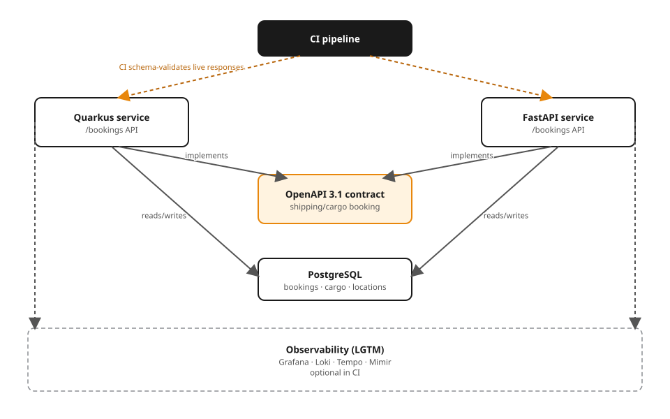

# Ch0 — Boot skeleton + Compose/LGTM

The toolchain-pin example for Part 0. Two tiny services — one Quarkus, one
FastAPI — answer a health check over Docker Compose, fronted by Postgres.
No resources, no contract yet: that's Ch4, where both stacks start serving
`contracts/openapi/shipping-api.yaml` for the **shipping/cargo** domain (a
customer books cargo for transport from an origin to a destination; see
`_plans/domain-glossary.md`). This chapter only proves the stack boots.

## Toolchain pins

| Component | Pin |
|---|---|
| Quarkus | 3.40.1 (latest stable LTS) |
| Java | 25 (LTS), UBI 10 `openjdk-25` / `openjdk-25-runtime`, JVM mode (fast-jar, not native) |
| Python | 3.14, managed with `uv`, UBI 10 `python-314-minimal` |
| Web framework | FastAPI + Uvicorn |
| Container base | Red Hat UBI 10 for both stacks (`Containerfile`, not `Dockerfile`) |
| Database | Postgres 17 (`shipping` database) |
| Observability | Grafana `otel-lgtm` (Loki/Grafana/Tempo/Mimir + OTel Collector), **opt-in** |

Exact UBI tags are pinned in each `Containerfile`; re-check with
`skopeo list-tags docker://registry.access.redhat.com/ubi10/<repo>` and bump
deliberately.

## Run it

Automated (what CI runs):

```bash
./verify.sh
```

Brings the app stack up with `docker compose`, polls both health endpoints,
asserts `200`, prints `PASS`, and tears the stack down — no orphaned
containers afterward.

Manual, app stack only (Quarkus + FastAPI + Postgres):

```bash
docker compose up --build
curl -s http://localhost:8080/q/health   # Quarkus liveness/readiness
curl -s http://localhost:8080/           # {"service":"shipping-quarkus","status":"up"}
curl -s http://localhost:8000/health     # FastAPI health
curl -s http://localhost:8000/           # {"service":"shipping-python","status":"up"}
docker compose down -v
```

Manual, with the observability profile (Grafana LGTM) added:

```bash
docker compose --profile observability up --build
# Grafana: http://localhost:3000 (anonymous admin)
```

The `observability` profile is **off by default** — `docker compose up` and
`verify.sh` never start it, so a first boot and CI both stay fast. Neither
app exports telemetry yet; OTel wiring lands with the contract-first build
in later chapters.

## Layout

```
00-prerequisites/
├── quarkus/        # minimal Quarkus app: GET / , health at /q/health
├── python/         # minimal FastAPI app: GET / , GET /health
├── compose.yaml    # quarkus + python + postgres, lgtm behind `observability` profile
├── verify.sh       # sources examples/_lib/lib.sh; health-only checks
├── architecture.svg / .excalidraw   # this example's topology figure
└── README.md
```

## Architecture



Editable source: `architecture.excalidraw`.
