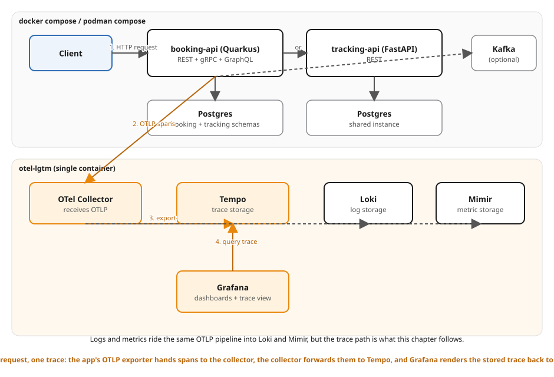

# Ch25 — Local dev with Docker Compose (and a trace end to end)

The booking create/read surface from `examples/24-testing` (same shared
contract, same two stacks), standing up the **full local dev substrate**:
Quarkus, FastAPI, Postgres, and the Grafana `otel-lgtm` observability
stack — all as DEFAULT `docker compose` services, not behind an opt-in
profile. Earlier chapters kept LGTM opt-in so a first boot and CI stayed
fast; this chapter's whole subject is tracing, so it's on by default.

The point isn't "add OpenTelemetry" in the abstract — it's proving a
**single, specific request** is traced end to end: POST a booking with a
*fixed* W3C `traceparent` header, and look that exact trace id up in Tempo
afterward. If it's not there, the pipeline is broken, full stop — no
fuzzy "search for something that looks right."

## What's new versus Ch24

| | Ch24 | Ch25 |
|---|---|---|
| `lgtm` service | opt-in (`--profile observability`), unused by either app | **default**, both apps export OTLP to it |
| OTel on Quarkus | not wired | `quarkus-opentelemetry`, OTLP/gRPC to `:4317` |
| OTel on FastAPI | not wired | `opentelemetry-sdk` + `FastAPIInstrumentor`, OTLP/HTTP to `:4318` |
| Trace propagation | n/a | both honor an inbound W3C `traceparent` — a request CONTINUES a trace id instead of starting a new one |
| `postgres` service | not present | present (per the Ch0 convention: in the topology from day one), **unused** by either app — this chapter's subject is tracing, not persistence |

## Instrumentation

**Quarkus** (`quarkus/src/main/resources/application.properties`):

```properties
quarkus.application.name=shipping-quarkus
quarkus.otel.exporter.otlp.endpoint=http://lgtm:4317
quarkus.otel.exporter.otlp.protocol=grpc
quarkus.otel.traces.sampler=always_on
```

`quarkus-opentelemetry` auto-instruments every JAX-RS endpoint (HTTP server
spans carrying `http.route` / `http.request.method`) and, via the default
W3C `tracecontext` propagator, treats an inbound `traceparent` header as
the *parent* of the new server span — so the exported span's trace id is
whatever the caller sent, not a freshly generated one.

**FastAPI** (`python/app/telemetry.py`, imported first thing in
`app/main.py`):

```python
resource = Resource.create({"service.name": _SERVICE_NAME})  # shipping-python
provider = TracerProvider(resource=resource, sampler=ALWAYS_ON)
exporter = OTLPSpanExporter(endpoint=f"{_OTLP_ENDPOINT}/v1/traces")  # http://lgtm:4318
provider.add_span_processor(BatchSpanProcessor(exporter))
trace.set_tracer_provider(provider)
FastAPIInstrumentor.instrument_app(app)
```

Same idea: `FastAPIInstrumentor`'s ASGI middleware extracts the inbound
`traceparent` via the default propagator and continues that trace id.
`ALWAYS_ON` sampling is hardcoded (not read from an env var) on purpose —
this chapter's assertion needs the one request it sends to be exported,
every time, deterministically.

## The trace assertion — why it's deterministic and bounded

A trace-based gate that searches Tempo for "a recent trace matching roughly
this shape" is fragile: it can match the wrong request, or hang forever if
nothing ever shows up. `verify.sh` avoids both failure modes:

1. **Deterministic.** Each stack gets ONE fixed, hand-picked 32-hex-char
   W3C trace id (never randomly generated):

   | Stack | Fixed trace id | Sent as |
   |---|---|---|
   | Quarkus | `1111111111111111aaaaaaaaaaaaaaaa` | `traceparent: 00-1111111111111111aaaaaaaaaaaaaaaa-fedcba9876543210-01` |
   | Python  | `2222222222222222bbbbbbbbbbbbbbbb` | `traceparent: 00-2222222222222222bbbbbbbbbbbbbbbb-0123456789abcdef-01` |

   `verify.sh` POSTs with that header, then queries
   `GET http://localhost:3200/api/traces/<that-exact-id>`. There's no
   ambiguity about which trace is "the one" — it's the id in the URL.

2. **Bounded.** The lookup is a sleep-poll with a **hard 30s timeout**
   (`TRACE_POLL_TIMEOUT` / `TRACE_POLL_INTERVAL` in `verify.sh`), because
   both stacks' `BatchSpanProcessor`s flush on their own schedule (~5s),
   not synchronously on response. Tempo returns `404` for a trace it
   hasn't ingested yet — verify.sh keeps polling on `404` and **fails
   fast** the moment the timeout elapses, rather than hanging CI. See
   "The drift probe" below for this failing on purpose.

3. **Structural, not a substring grep.** Once Tempo returns `200`,
   `verify.sh` parses the trace JSON with `jq` and asserts, independent of
   whether the payload nests spans under `batches` or `resourceSpans`:
   - some **resource** attribute `service.name` equals the stack's service
     name (`shipping-quarkus` / `shipping-python`)
   - some **span** attribute (`http.route`, `url.path`, or `http.target`)
     equals `/bookings`
   - some **span** attribute (`http.request.method` or `http.method`)
     equals `POST`

   All three come from a REAL exported trace — nothing here mocks Tempo or
   short-circuits the query. Health-gating matters here too:
   `wait_for_http` polls `http://localhost:3200/ready` before any traffic
   is sent, because the `lgtm` container's own Docker healthcheck (hitting
   Grafana's `/api/health`) only proves Grafana's HTTP frontend is up — not
   that Tempo has finished its own startup inside the same container.

## Run it

```bash
cd examples/25-local-with-docker-compose
./verify.sh
```

Brings up all four services (`quarkus`, `python`, `postgres`, `lgtm`),
waits for both apps' health endpoints and Tempo's `/ready`, then for each
stack: POSTs a traced booking (`201` + `Location`, body validates against
`#/$defs/Booking`), polls Tempo for that exact trace id, and asserts the
service name + route/method span attributes. Prints `PASS` only if every
step holds for both stacks, then tears the stack down (`down -v
--remove-orphans`) — verified clean across repeated runs (no leaked
containers, networks, or volumes).

Manual walkthrough with Grafana:

```bash
docker compose up --build
# Grafana: http://localhost:3000 (anonymous admin, no login needed)
```

In Grafana:

1. Open **Explore** (compass icon in the left rail).
2. Pick the **Tempo** data source (provisioned automatically by the
   `otel-lgtm` image — no datasource setup needed).
3. Query by TraceID: paste `1111111111111111aaaaaaaaaaaaaaaa` (Quarkus) or
   `2222222222222222bbbbbbbbbbbbbbbb` (Python) into the TraceID search box.
4. The trace view shows the `POST /bookings` server span (and, on the
   Python side, the ASGI `http send`/`http receive` internal spans
   `FastAPIInstrumentor` adds around it) with the `http.route`,
   `http.request.method`/`http.method`, and `http.response.status_code`
   attributes `verify.sh` asserts on structurally.

Or skip Grafana and query Tempo's HTTP API directly, the same way
`verify.sh` does:

```bash
curl -s -H 'Accept: application/json' \
  http://localhost:3200/api/traces/1111111111111111aaaaaaaaaaaaaaaa | jq .
```

```bash
docker compose down -v
```

## The drift probe

To see the trace assertion actually reject a broken pipeline — not just a
response that's wrong in some other way — point one stack's exporter at a
dead endpoint and re-run:

In `compose.yaml`, add to the `python` service:

```yaml
  python:
    environment:
      - OTEL_EXPORTER_OTLP_ENDPOINT=http://lgtm:9999   # BUG: nothing listens here
```

Re-run `./verify.sh`. The Quarkus half still passes (its trace lands in
Tempo normally); the Python POST still returns `201` with a valid body
(the app doesn't know its spans are going nowhere) — but Step 4's Tempo
poll never finds `2222222222222222bbbbbbbbbbbbbbbb`, and **fails fast at
the 30-second timeout** instead of hanging:

```
=== Step 4: Tempo trace lookup — 'python' (trace 2222222222222222bbbbbbbbbbbbbbbb) ===
verify.sh: polling Tempo for trace 2222222222222222bbbbbbbbbbbbbbbb (timeout 30s) ...
verify.sh: FAIL — Tempo never returned trace 2222222222222222bbbbbbbbbbbbbbbb within 30s (last HTTP code: 404)
```

The stack still tears down cleanly (`compose_down` runs from the `EXIT`
trap regardless of where the script failed). Revert the edit and re-run —
it goes back to `PASS`. This is the gate with teeth: a response can be
perfectly schema-valid and still mean the observability pipeline is
silently broken, which is exactly the failure mode a trace-based CI check
exists to catch.

## Ports

| Service | Host port(s) | Container port(s) | Notes |
|---|---|---|---|
| Quarkus | 8105 | 8080 | `/q/health`, `/bookings` |
| FastAPI | 8024 | 8000 | `/health`, `/bookings` |
| Postgres | 5432 | 5432 | present, unused (see "What's new" above) |
| `lgtm` (Grafana) | 3000 | 3000 | anonymous admin |
| `lgtm` (OTLP gRPC) | 4317 | 4317 | Quarkus exports here |
| `lgtm` (OTLP HTTP) | 4318 | 4318 | FastAPI exports here |
| `lgtm` (Prometheus/Mimir) | 9090 | 9090 | not exercised by this chapter |
| `lgtm` (Loki) | 3100 | 3100 | not exercised by this chapter |
| `lgtm` (Tempo query API) | 3200 | 3200 | `verify.sh` polls `/ready` then `/api/traces/<id>` |

Compose project: `ch25-compose`.

## Layout

```
25-local-with-docker-compose/
├── quarkus/        # Ch24's booking create/read surface + quarkus-opentelemetry
├── python/         # same surface + app/telemetry.py (OTel SDK + FastAPIInstrumentor)
├── compose.yaml    # quarkus + python + postgres + lgtm, ALL default (no profile)
├── verify.sh       # sources examples/_lib/lib.sh; traced-booking + bounded Tempo lookup
├── architecture.svg / .excalidraw   # this example's topology figure
└── README.md
```

## Architecture



Editable source: `architecture.excalidraw`.
