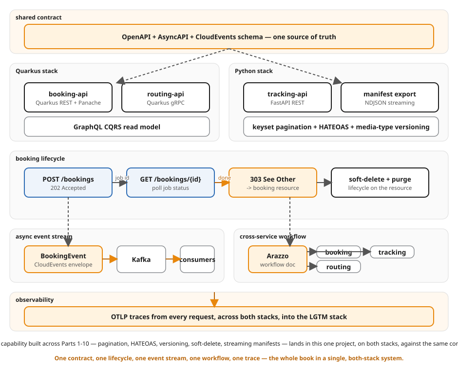

# Ch27 — The complete project: one booking service, the whole book

Every prior chapter built ONE idea against a thin slice of the shipping
domain — pagination in isolation, async operations in isolation, HATEOAS in
isolation. This chapter assembles them into a single, cohesive booking
service — on both stacks — and proves the whole flow end to end: create a
booking, confirm it asynchronously, page through a collection, negotiate a
representation, soft-delete and purge it for GDPR, stream its manifest
incrementally, and watch a CloudEvents-enveloped domain event land on
Kafka. Nothing here is new *content* — it's the same contract
(`contracts/schemas/shipping.schema.json`), the same two stacks (Quarkus
3.40.1 LTS / FastAPI on Python 3.14), re-assembled around one coherent
`Booking` resource instead of ten separate teaching examples.



## The capability-to-chapter map

| # | Capability | Endpoint(s) | Source chapter |
|---|---|---|---|
| 1 | Contract-first create/read | `POST /bookings`, `GET /bookings/{id}` | Ch4 (contract-first anchor) |
| 2 | Keyset pagination | `GET /bookings?limit=&cursor=` | Ch8 (pagination) — cursor/keyset strategy only |
| 3 | HATEOAS `_links` | every `Booking`/`BookingCollection` response | Ch12 (HATEOAS) |
| 4 | Async confirmation | `POST /bookings/{id}/confirmation` → 202, `GET /operations/{id}` → 200/303 | Ch10 (async operations) |
| 5 | Media-type versioning | `GET /bookings/{id}` + `Accept: .../v1+json` vs `.../v2+json` | Ch14 (versioning) — media-type strategy only |
| 6 | Soft delete + GDPR purge | `DELETE /bookings/{id}`, `DELETE /bookings/{id}/purge` | Ch13 (soft-delete-purge) |
| 7 | NDJSON manifest, streamed incrementally | `GET /bookings/{id}/manifest/export` | Ch16 (streaming) — NDJSON + the `NdjsonMessageBodyWriter` fix |
| 8 | Background CloudEvents over Kafka | fired when an async confirmation completes | Ch21 (multi-protocol-contracts) |
| 9 | Shared schema + Arazzo | static checks in `verify.sh` | Ch21's `check_arazzo.py`, `contracts/arazzo/booking-workflow.yaml` |

Each capability is assembled from the chapter's existing handler/store
pattern, adapted to live on one `Booking` aggregate instead of its own
narrow example. Nothing here reinvents a pattern the earlier chapters
already taught; this chapter's own code is the glue — `OperationStore`
calling `BookingEventPublisher` once a confirmation actually completes,
`HateoasLinks` reflecting the same state machine `VersionMapper` and the
soft-delete view both respect, `ManifestEventGenerator` reusing the exact
`BookingEvent` shape the Kafka publish uses.

## What happens on a full run

```
POST /bookings                              -> 201 PENDING, _links{confirm,cancel}
POST /bookings/{id}/confirmation            -> 202 Operation(RUNNING), Location: /operations/{opId}
   ... background worker (bounded delay) ...
GET  /operations/{opId}                     -> 200 Operation(RUNNING)   [first poll(s)]
GET  /operations/{opId}                     -> 303 See Other -> /bookings/{id}  [once SUCCEEDED]
                                                  (booking flips to CONFIRMED;
                                                   a CloudEvents BookingEvent is
                                                   published to shipping.bookings.lifecycle)
GET  /bookings/{id}                         -> 200 CONFIRMED, _links{cancel}
GET  /bookings/{id}  Accept: .../v1+json    -> 200 {cargoDescription, price}  (frozen v1)
GET  /bookings/{id}  Accept: .../v2+json    -> 200 {cargo[], quote}          (current v2)
DELETE /bookings/{id}                       -> 204  (soft delete: status -> CANCELLED)
GET  /bookings/{id}                         -> 404  (hidden by default)
GET  /bookings/{id}?includeDeleted=true     -> 200 CANCELLED + X-Audit-Deleted-At/-Reason
DELETE /bookings/{id}/purge                 -> 204  (GDPR erasure)
GET  /bookings/{id}?includeDeleted=true     -> 404  (gone for good — even the audit view)
```

In parallel, `GET /bookings?limit=N` walks a stable keyset page by page
(`page.nextCursor` is the opaque continuation token), and
`GET /bookings/{id}/manifest/export` streams a six-line NDJSON manifest of
that booking's lifecycle, one `BookingEvent` line roughly every 250ms — a
client reading it with `curl -N` sees the lines arrive over time, not all
at once.

## The service

One resource, the whole book's flow:

- **Quarkus** (`quarkus/`) — `BookingResource` (create, list, get, confirm,
  soft-delete, purge, versioning negotiation), `OperationResource` (poll),
  `ManifestResource` (NDJSON export), `OperationStore` (the confirmation
  worker — on success, flips the booking via `BookingStore.confirm()` and
  calls `BookingEventPublisher.publishConfirmed()`), `HateoasLinks`,
  `VersionMapper`, `NdjsonMessageBodyWriter` (the raw-bytes fix Ch16
  needed for `application/x-ndjson` + `String`).
- **FastAPI** (`python/app/`) — `main.py` (all routes), `operations.py`
  (the `asyncio.create_task` confirmation worker, mirroring
  `OperationStore`), `hateoas.py`, `manifest.py`, `events.py` (the
  `confluent-kafka` CloudEvents publish), `store.py`.

Both stacks keep the booking in memory (same as every other chapter in
this book) — Ch27's job is proving the *protocol* surface works end to
end on one resource, not persistence. A Postgres container fits the
topology convention used elsewhere (Ch25), but neither app would use it
for anything; it's left out here to keep the compose file and the CI gate
lean. See the OpenShift/CRC appendix convention note below for where
persistence would actually land in a production-shaped version of this
service.

## Run it

```bash
cd examples/27-complete-project
docker compose up --build
# Quarkus: http://localhost:8106
# FastAPI: http://localhost:8025
# Kafka (external listener, host tooling): localhost:19093
```

```bash
# Create + confirm a booking (Quarkus; swap 8106 for 8025 for FastAPI):
curl -s -X POST http://localhost:8106/bookings \
  -H 'Content-Type: application/json' \
  -d '{"origin":{"unLocode":"USNYC"},"destination":{"unLocode":"NLRTM"},"cargo":[{"description":"Electronics","type":"GENERAL","dimensions":{"weightKg":1200.5}}]}' | jq .

curl -s -X POST http://localhost:8106/bookings/<id>/confirmation -i | head -5
# ... wait ~1.5s, then:
curl -s http://localhost:8106/operations/<opId> -i | head -5     # 303 once done

# NDJSON manifest, watch it arrive line by line:
curl -N http://localhost:8106/bookings/<id>/manifest/export

# Watch the CloudEvent land on Kafka:
docker compose -p ch27-complete exec kafka \
  /opt/kafka/bin/kafka-console-consumer.sh --bootstrap-server localhost:9092 \
  --topic shipping.bookings.lifecycle --from-beginning --max-messages 1
```

## Verify

```bash
cd examples/27-complete-project
bash verify.sh
```

`verify.sh` is deterministic and bounded: a fixed-size NDJSON manifest with
a fixed per-line delay, a capped confirmation poll loop, and a
`[[ -s file ]]` guard on the Kafka consumer output (the
`kafka-console-consumer` "exits 0 on timeout with zero messages" footgun
Ch21 already had to guard against). It runs the full ten-point flow for
Quarkus, then for FastAPI, then tears the stack down — `docker compose
down -v --remove-orphans` — so nothing leaks between runs. Run it twice
back to back to see the repeatability: no leftover containers, networks,
volumes, or Kafka topics/consumer groups (each run uses a
PID-suffixed consumer group).

## Local-only: tracing and load (kept OUT of this gate)

**Tracing.** Ch25 (`examples/25-local-with-docker-compose`) already proves
end-to-end OTLP trace export into a Grafana LGTM stack in CI. Wiring OTel
into this chapter's project too would duplicate that gate without adding coverage,
and would balloon this already-broad verify.sh. The `lgtm` service here is
real and runnable, just behind an opt-in profile:

```bash
docker compose --profile observability up --build
# Grafana: http://localhost:3000 (anonymous admin)
```

Neither app is instrumented to export to it in this chapter (that's Ch25's
job) — the service is included so a reader experimenting locally has
somewhere to point OTel exporters without editing compose.yaml.

**Load.** Newman (`examples/_lib` convention: REST collections) and kcat
(Kafka inspection) are the house tools for exercising this service under
load or watching the topic interactively — see the root `README.md`'s
tooling section. Deliberately not part of `verify.sh`: a correctness gate
and a load/perf run have different failure budgets and different runtimes,
and conflating them makes the CI gate both slower and flakier.

## The drift probe

To see the Ch16-style incremental-delivery assertion actually catch a
regression, introduce this edit and re-run `./verify.sh`:

**Buffer the manifest export instead of streaming it.**

In `python/app/main.py`'s `_manifest_stream`, move the sleep so every line
is generated up front and yielded in one burst:

```python
async def _manifest_stream(booking_id: str) -> AsyncIterator[str]:
    lines = [json.dumps(manifest.event_for(booking_id, i)) + "\n" for i in range(manifest.LINE_COUNT)]
    await asyncio.sleep(manifest.LINE_COUNT * manifest.INTERVAL_SECONDS)  # same total wall-clock cost
    for line in lines:
        yield line
```

Re-run `bash verify.sh`. The manifest export still returns 200 with the
right `Content-Type` and the right number of valid `BookingEvent` lines —
every assertion that stops at "status code and shape" still passes. The
timing assertion is what catches it: all six lines now arrive within the
same OS pipe read, microseconds apart, and
`spread ${spread}s is below the ${MANIFEST_MIN_SPREAD_SECONDS}s floor`
fails loudly. Revert the edit before moving on — this change is for
seeing the gate work, not for shipping.

## Repeatability

```bash
bash verify.sh && bash verify.sh
```

Both runs should print the same `PASS` line and leave nothing behind:

```bash
docker ps -a --filter "label=com.docker.compose.project=ch27-complete"   # empty
docker network ls --filter "name=ch27-complete"                          # empty
docker volume ls --filter "label=com.docker.compose.project=ch27-complete" # empty
```

## Nothing new, assembled differently

If you've read the rest of this book, every individual mechanic here is
already familiar: the keyset cursor is Ch8's `encodeCursor`/`decodeCursor`
verbatim; `HateoasLinks` is Ch12's state-driven relation map; the
confirmation protocol is Ch10's `OperationStore` with one line added
(publish the CloudEvent on success); the versioning negotiation is Ch14's
`VersionMapper` with the vendor media type renamed to
`application/vnd.shipping.booking.v{1,2}+json`; soft-delete/purge is Ch13's
`BookingStore` audit trail; the NDJSON manifest is Ch16's
`NdjsonMessageBodyWriter` fix applied to a new, booking-scoped generator;
and the Kafka publish is Ch21's `BookingEventPublisher`, just triggered
from the operation's completion callback instead of the request thread.
The point of this chapter isn't a new idea — it's proving all of those
ideas compose on one resource without stepping on each other's state.
